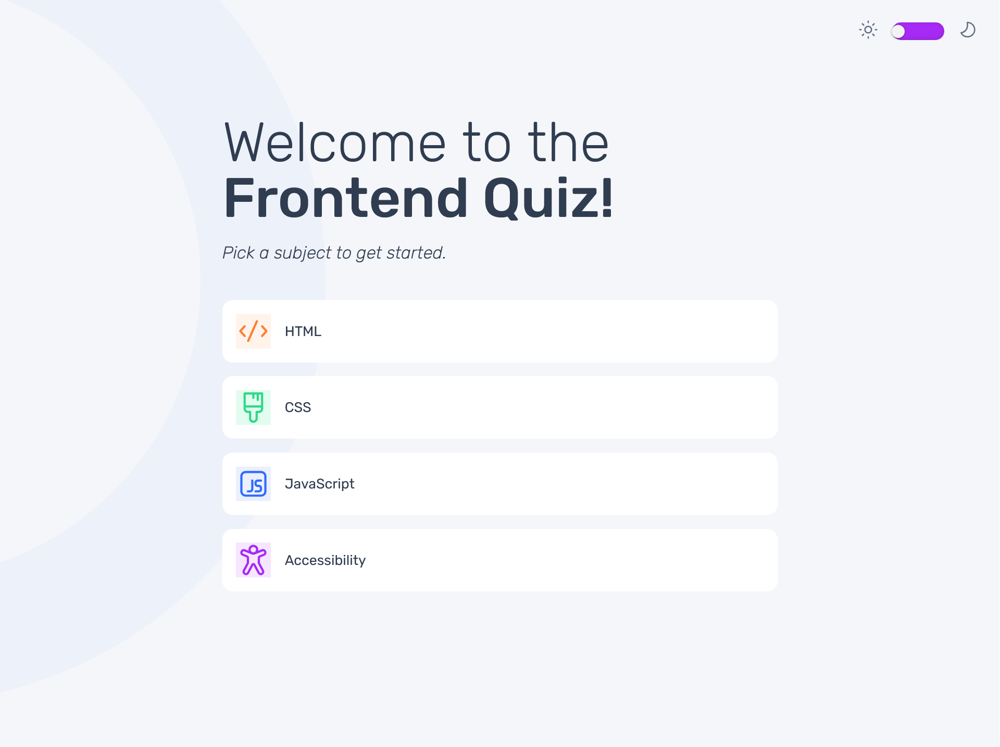
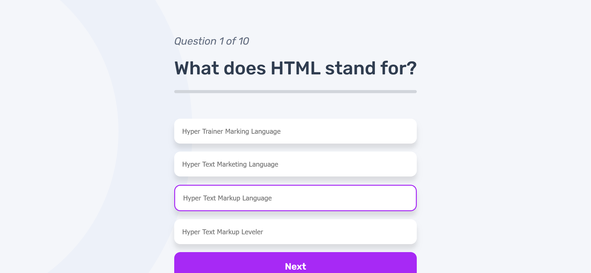
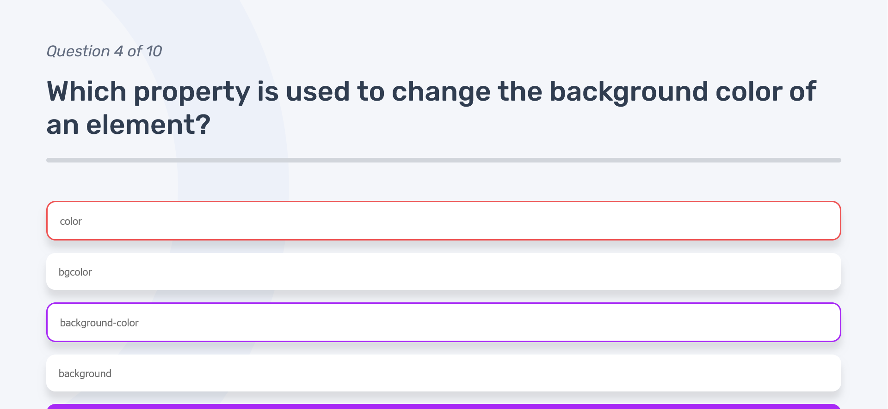
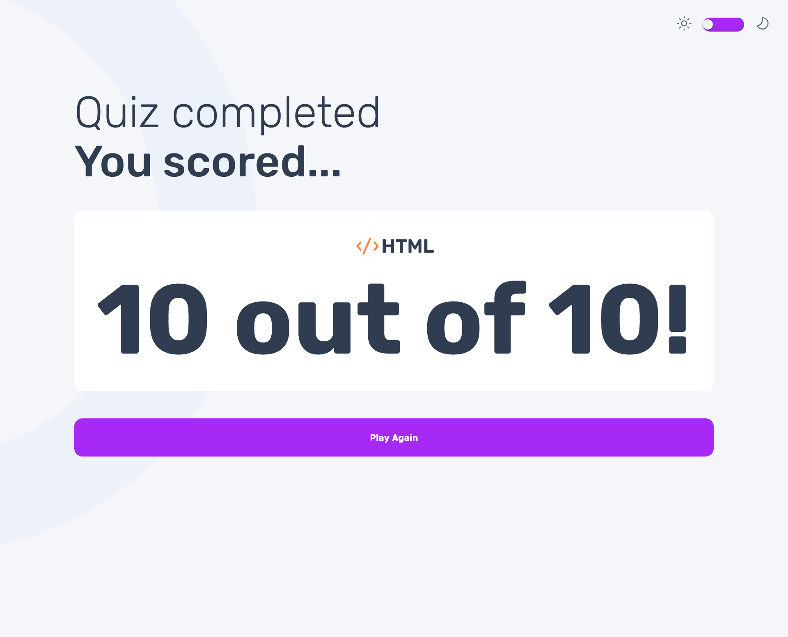

# Frontend Mentor - Frontend quiz app solution

This is a solution to the [Frontend quiz app challenge on Frontend Mentor](https://www.frontendmentor.io/challenges/frontend-quiz-app-BE7xkzXQnU). Frontend Mentor challenges help you improve your coding skills by building realistic projects. 

## Table of contents

- [Overview](#overview)
  - [The challenge](#the-challenge)
  - [Screenshot](#screenshot)
  - [Links](#links)
- [My process](#my-process)
  - [Built with](#built-with)
  - [What I learned](#what-i-learned)
  - [Continued development](#continued-development)
  - [Useful resources](#useful-resources)
  - [AI Collaboration](#ai-collaboration)
- [Author](#author)
- [Acknowledgments](#acknowledgments)


## Overview

### The challenge

Users should be able to:

- Select a quiz subject
- Select a single answer from each question from a choice of four
- See an error message when trying to submit an answer without making a selection
- See if they have made a correct or incorrect choice when they submit an answer
- Move on to the next question after seeing the question result
- See a completed state with the score after the final question
- Play again to choose another subject
- View the optimal layout for the interface depending on their device's screen size
- See hover and focus states for all interactive elements on the page
- Navigate the entire app only using their keyboard
- **Bonus**: Change the app's theme between light and dark

### Screenshot







### Links

- Solution URL: [Solution URL](https://github.com/nottohave/Frontend-Quiz-App)
- Live Site URL: [Live site URL](https://nottohave.github.io/Frontend-Quiz-App/)

## My process

### Built with

- Semantic HTML5 markup
- CSS custom properties
- Flexbox
- Mobile-first workflow


### What I learned

Use this section to recap over some of your major learnings while working through this project. Writing these out and providing code samples of areas you want to highlight is a great way to reinforce your own knowledge.

To see how you can add code snippets, see below:

```html
<h1>Almost everything tags has a class. 
Below is the toggle theme button</h1>
<label for="theme" class="theme">
  <span class="theme--text">
    
  </span>
  <input type="checkbox" id="theme">
  <span class="theme--btn"></span>
  <span class="theme--text">
    

```
```css
.answer-a:hover, .answer-b:hover, .answer-c:hover,
.answer-d:hover { border: 2px solid var(--purple-600)}
```
```js
function startQuiz() {
    currentQuestionIndex = 0;
    score = 0;
    nextButton.innerHTML = "Next";
    html.addEventListener("click", htmlQuiz);
    css.addEventListener("click", cssQuiz);
    javascript.addEventListener("click", javascriptQuiz);
    accessibility.addEventListener("click", accessibilityQuiz);
}
```

If you want more help with writing markdown, we'd recommend checking out [The Markdown Guide](https://www.markdownguide.org/) to learn more.

### Continued development

Use this section to outline areas that you want to continue focusing on in future projects. These could be concepts you're still not completely comfortable with or techniques you found useful that you want to refine and perfect.

- The live site on github doesn't handle promise. I do not know why. However, if you download the code and run it on VSCode then this project works fine. 
- See an error message when trying to submit an answer without making a selection
- See if they have made a correct or incorrect choice when they submit an answer. For this line: if user choose the right answer, then there will be purple border for their answer indicating the correct answer.


### Useful resources

- Search youtube videos on "frontend quiz app" then I watch the videos and follow their example. Then I implement it on the project.
- [Create a toggle theme button](https://youtu.be/8aZ2vla5PYI?si=yeMA29LHtudx3atJ) This video helps me on creating the toggle button for theme.


### AI Collaboration

Describe how you used AI tools (if any) during this project. This helps demonstrate your ability to work effectively with AI assistants.

- What tools did you use (e.g., ChatGPT, Claude, GitHub Copilot)?
- How did you use them (e.g., debugging, generating boilerplate, brainstorming solutions)?
- What worked well? What didn't?

I did not use AI to check my work. I used google search AI for samples.


## Author

- Frontend Mentor - [@nottohave](https://www.frontendmentor.io/profile/nottohave)


## Acknowledgments

Frontend Mentor